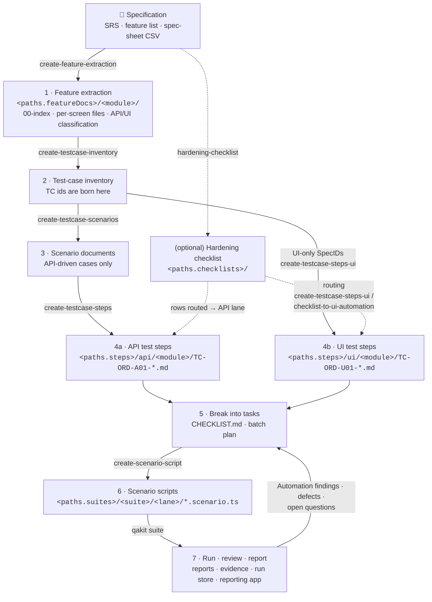
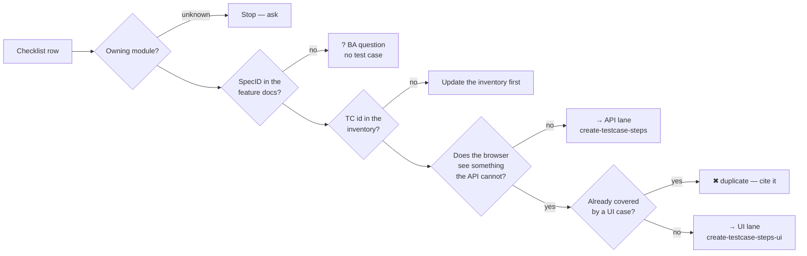
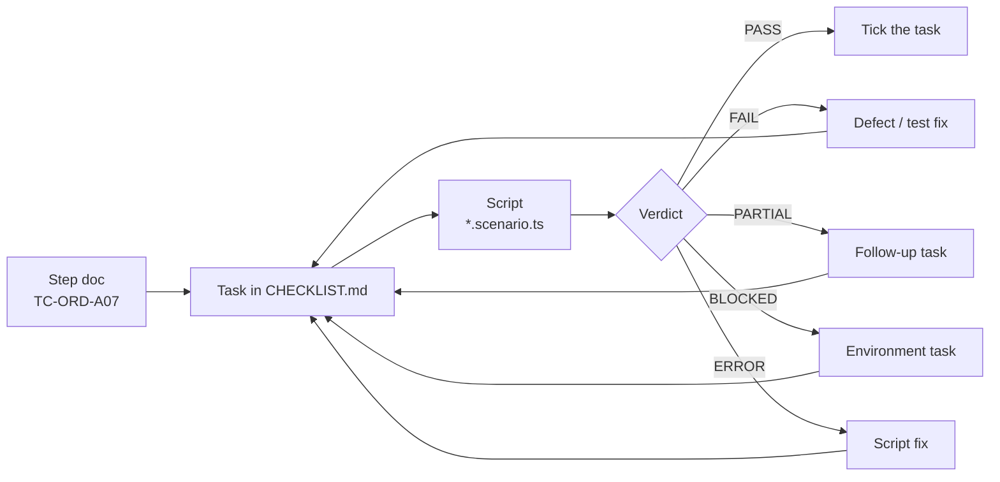
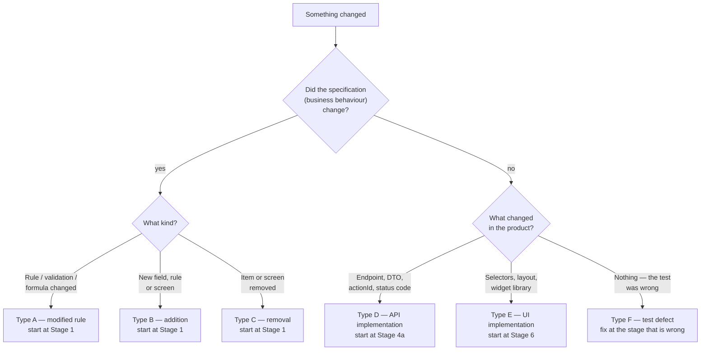
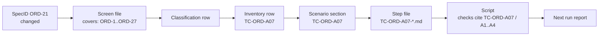

# Using the QA automation kit — from spec to running tests

This guide is for QA engineers and developers in a project that has already adopted the kit (see
[ADOPTING.md](../ADOPTING.md) for setup). It covers the day-to-day workflow:

1. turn a specification (SRS, feature list, spec sheet) into field-level feature documents,
2. derive test cases, test steps and automation scripts from them,
3. break the work into tasks and track it,
4. run, review and report,
5. **keep everything in sync when the feature changes**.

Examples use the kit's neutral sample module `orders` (test-case prefix `ORD`). Paths are written as
`qakit.config.yaml` keys, such as `<paths.featureDocs>`. Each one is relative to the config file's folder.

---

## 1. The big picture

Every stage is owned by one QA skill. Each stage reads **only** the output of the stage before it, and
each output is a file in the repository. The chain of files is the traceability: a line in a run report
can be traced back to the spec sentence it tests.



| # | Stage | Skill | Input | Output | Gate before moving on |
|---|---|---|---|---|---|
| 1 | Feature extraction | `create-feature-extraction` | Spec (CSV sheet or SRS document) | `00-index.md`, one file per screen, API/UI classification file | Every source row has a SpecID; counts match the source; anomalies listed under *Needs confirmation / Unclear*; `status: stable` |
| — | Hardening checklist *(optional)* | `hardening-checklist` | Spec + checklist template | Checklist workbook | The generator's quality gate passes; a person has reviewed it |
| 2 | Inventory | `create-testcase-inventory` | Extraction set | `NN-testcase-inventory.md` | Every API-lane SpecID is covered or excluded with a reason; UI-only and insufficient-data items are separated |
| 3 | Scenarios | `create-testcase-scenarios` | Inventory | `NN-testcase-scenarios.md` (+ child files) | Scenario count = inventory API-driven count; ambiguity tags copied exactly |
| 4a | API test steps | `create-testcase-steps` | Scenarios | One step file per TC, `API-MAP.md`, `CHECKLIST.md` | Files out = scenarios in; every actionId is in `API-MAP.md` or marked unconfirmed |
| 4b | UI test steps | `create-testcase-steps-ui` | Inventory UI-only rows, scenarios, checklists | One `U`-series step file per TC, `CRUD-MAP.md`, routing file | The gate verdict is written down for every candidate |
| 5 | Break into tasks | (you) | Step docs | `CHECKLIST.md` rows, batch plan | Every task has a TC id, a lane, dependencies and a definition of done |
| 6 | Scripts | `create-scenario-script` | One step doc | `*.scenario.ts` | Typecheck passes; one `check()` per assertion id; dry run works |
| 7 | Run & report | `qakit suite` | Scripts | Reports, evidence, run-store rows | Verdicts reviewed; the step doc's *Automation findings* are updated |

`checklist-to-ui-automation` runs stages 4b → 6 in one go when you start from a QA checklist.
`api-mcp` is not a stage. It lets you (or the skills) look up and call real backend operations while you
write steps and scripts.

---

## 2. Ground rules that apply to every stage

These rules are what keep the chain honest. Every skill enforces them, and reviewers should too.

1. **Source-faithful, or not at all.** Never invent a business rule, validation, endpoint, field name
   or error message. If the source does not say it, record it as an open question with the project's
   *needs confirmation* marker. An invented rule is a worse failure than a missing case.
2. **Business wording stays verbatim.** Keep the source language as written, including typos and
   contradictions. Report them; never fix them silently.
3. **Test-case ids are born in the inventory.** A step file or script never creates a TC id. Ids are
   never renumbered or reused.
4. **The file name and folder are the join key.** `TC-ORD-A07-<slug>.md` lives in
   `<paths.steps>/api/<module dir>/`, and its script cites `TC-ORD-A07`. Don't rename one side alone.
5. **Assertion ids (`A1`, `A2`, ...) are load-bearing.** Scripts cite them as `TC-ORD-A07 / A2`, and
   so do reports. Once automation exists, add new ids instead of renumbering old ones.
6. **Downstream never edits upstream.** A step pass that finds a scenario is wrong records the
   divergence (*Open questions*, *Automation findings*). A separate pass then fixes the source of
   truth.
7. **Writes are opt-in.** API and browser writes stay blocked unless the project's `allowWritesEnv`
   switch is `1`. Never point write-enabled runs at a shared environment.
8. **A person reviews every stage.** The AI drafts; a person approves the draft before it becomes the
   next stage's input.

---

## 3. Stage by stage

You invoke each skill in Claude Code by describing the task, for example *"extract the orders sheet
into feature docs"*, or by naming the skill.

### Stage 1 — Extract the specification into feature documents

**Ask:** *"Extract `<spec file>` into the field-level feature docs for module `orders`."*

- **Input:** under `<paths.specSource>`, a spec-sheet CSV or a structured Markdown SRS / screen spec.
  The output shape is the same for both; for Markdown, `derives_from` points at `doc:<path>#<section>`
  instead of a sheet, and the ids the document already carries (`BR-OR01`, `ACT-OR02`) become the
  SpecIDs verbatim.
- **Output:** `<paths.featureDocs>/<module>/`:
  - `00-index.md`: overview, a file ↔ feature code ↔ source mapping, SpecID conventions and open points
  - one file per screen or section, with every field, rule, action and edge case, each with a SpecID
  - `NN-api-ui-classification.md`: every SpecID assigned to **API**, **UI** or **Insufficient data**
- **Check before continuing:**
  - [ ] Item counts in `00-index.md` match the source (count with a script, not by eye).
  - [ ] SpecIDs the source already has are reused verbatim. New ones are generated only for unnamed items.
  - [ ] Each file's frontmatter has `derives_from`, a `covers` range and `status`.
  - [ ] Every anomaly is listed. None is corrected.
  - [ ] A BA or product owner has answered, or at least seen, the `[BLOCKING]` questions.

### Stage 2 — Build the test-case inventory

**Ask:** *"Create the test-case inventory for `orders`."*

- Groups SpecIDs into business rules, and assigns TC ids (`TC-ORD-A01`, ...) and priorities.
- UI-only items go into a separate list. They become `U`-series cases in stage 4b.
- Items with insufficient data are excluded, with a reason.

**Check:** every API-lane SpecID from the classification file is either covered by a TC or explicitly
excluded. Every TC id matches `ids.testCase`.

### Stage 3 — Write the scenario documents

**Ask:** *"Turn the orders inventory into scenarios."*

One scenario per inventory test case: business rule, API and assertion intent, scope, exclusions,
ambiguity and traceability. **No execution steps yet.**

**Check:** scenario count = the inventory's API-driven count. The ambiguity tags are identical to the
inventory's.

### Stage 4 — Write the test steps

**API lane.** *"Generate API test steps for `orders`."* (`create-testcase-steps`)

**UI lane.** *"Generate UI test steps for the orders UI-only SpecIDs."* (`create-testcase-steps-ui`)

Each step file follows `templates/api-test-steps.md` or `templates/ui-test-steps.md`:

| Section | What it pins down |
|---|---|
| Test overview | TC id, module, SpecIDs covered, primary rule, priority |
| Business rule | Precondition → action → expected behaviour, in business language |
| Traceability | Why each SpecID is needed |
| Test data / Preconditions | Every dynamic value and where it comes from |
| Step matrix | `Setup / Execute / Verify / Cleanup` rows with API/actionId, input, expected result, evidence |
| Assertions | `A1`, `A2`, ... (stable ids) |
| Pass / fail rule | PASS and FAIL in terms of assertion ids |
| Notes for automation / Open questions | What is confirmed and what still needs checking against the source |
| Automation findings | **Added after automation.** Corrects earlier assumptions without rewriting them |

Use the API MCP server (`api-mcp`) to confirm real actionIds. Never guess a route from a field label.

**Starting from a QA checklist instead?** Use `checklist-to-ui-automation`. It **routes** every row to
a module, SpecID and lane *before* anything is written. Rows without a SpecID become BA questions, and
rows routed to the API lane go to `create-testcase-steps`.



### Stage 5 — Break the work into tasks

Step docs are the natural unit of work: **one TC = one step file = one script = one task**. Before you
start automating:

1. **List the tasks** in the module's `CHECKLIST.md`, one row per TC:
   `Done | TC ID | Name | Step file | Automation | Status`.
2. **Batch along data dependencies, not equal sizes.** For a large module (roughly more than 60 TCs),
   write a batch plan. A useful order: independent fields → tables and imports → formula chains →
   status and cumulative rules → blocked cases last.
3. **Mark blockers explicitly.** A TC whose step doc still has `[BLOCKING]` or unconfirmed actionIds is
   either a *confirm with the source/BA* task or a `NOT_EVALUATED` assertion. It is never a hard assertion.
4. **Give each task a definition of done:**
   - step doc reviewed
   - script written; `pnpm typecheck` / `npm run typecheck` passes
   - scenario runs with a real verdict (not `ERROR`)
   - *Automation findings* updated
   - `CHECKLIST.md` row ticked
5. **Feed run results back as tasks.** Each non-PASS verdict becomes one of these:

| Verdict | Meaning | Becomes |
|---|---|---|
| `FAIL` | A check failed | A defect (the reporting app can file it in the tracker), or a test fix if the test was wrong |
| `PARTIAL` | Some assertions proven, others blocked or `NOT_EVALUATED` | A follow-up task for the unproven assertions |
| `BLOCKED` | The environment could not run it (writes off, no credentials, missing build) | An environment/setup task, not a regression |
| `ERROR` | The scenario itself crashed | A script fix |
| Open question | The spec is unclear | A BA question; the TC stays blocked until it is answered |



### Stage 6 — Write the automation scripts

**Ask:** *"Automate TC-ORD-A07."* (`create-scenario-script`)

- Output: `<paths.suites>/<suite>/<api|ui>/<slug>.scenario.ts`, built on `defineApiScenario` or
  `defineUiScenario`. A UI scenario drives the web app (`ctx.ui()`), the desktop app (`ctx.desktop()`, see
  [desktop-testing.md](desktop-testing.md)), or both.
- One `check()` per assertion id, citing `TC-ORD-A07 / A2`.
- New HTTP lookups go into the project's data provider or flow modules, not inline in the scenario. A
  scenario never imports the run store.
- Data-changing steps are gated on the writes switch. Test data carries `safety.testDataMarker` and is
  cleaned up in `finally`.
- After tracing the real backend, add an **Automation findings** section to the step doc. Record what was
  assumed and what is actually true, with the exact source class/field or live evidence.

### Stage 7 — Run, review, report

```bash
npx qakit suite --config qakit.config.yaml --list                  # what exists
npx qakit suite --config qakit.config.yaml --kind api              # a lane
npx qakit suite --config qakit.config.yaml --testcase TC-ORD-A07   # one case
```

Every run writes a Markdown report (`reports/`), a JSON artifact (`outputs/`), evidence (`evidence/`)
and a row in the SQLite run store. Import the store into the reporting app
([reporting-app.md](reporting-app.md)) to review verdicts, record decisions and file defects. Never
hand-write the generated report. For a written verdict for people, write a separate recap report.

---

## 4. When the feature is updated

Specs change: a new SRS version, a changed business rule, a new field, a removed screen, a renamed
endpoint. **The rule is to update top-down, in pipeline order, and never patch a downstream file to
match a spec that its upstream documents don't yet reflect.** If you fix a script first, the step doc,
scenario and inventory go stale. The next person who regenerates them undoes your fix.

### 4.1 Classify the change first



| Type | Example | Start at | Stages touched |
|---|---|---|---|
| **A · Modified rule** | Discount cap changes from 10% to 15% | 1 Extraction | 1 → 2 → 3 → 4 → 6 → 7 |
| **B · Addition** | New *Delivery date* field with a validation | 1 Extraction | 1 → 2 (new TC ids) → 3 → 4 → 5 → 6 → 7 |
| **C · Removal** | The *Draft* status is dropped | 1 Extraction | 1 → 2 (retire TCs) → 3 → 4 → 6 → 7 |
| **D · API implementation** | `POST /orders` becomes `POST /v2/orders`, same rule | 4a Steps | `API-MAP.md` and *Automation findings* → 6 → 7 |
| **E · UI implementation** | Save button moves into a menu | 6 Scripts | Selectors, screens and widget adapters → 7 (step doc only if the user-visible flow changed) |
| **F · Test defect** | The assertion compared the wrong field | The wrong stage | That stage and everything below it |

### 4.2 Find the impact

The frontmatter and file names form a graph, so impact can be found by search instead of memory:

```bash
# 1. Which SpecIDs changed? Diff the source (new CSV export or new SRS version) against the old one.
git diff <old>..<new> -- <spec file>

# 2. Where is each changed SpecID used, at every stage?
grep -rn "ORD-21" <paths.featureDocs> <paths.steps> <paths.suites>

# 3. Which TCs cover it? Check the inventory rows and the step files' "Covered SpecID" column.
grep -rln "ORD-21" <paths.steps>

# 4. Which scripts implement those TCs?
grep -rln "TC-ORD-A07" <paths.suites>
```

Write the result down as an **impact list** before you change anything:
`SpecID → inventory TC → scenario → step file → script`. That list is your task list for the update.
Track it the way stage 5 describes.



### 4.3 Apply the update, stage by stage

For each stage on the impact list, run the stage's skill **in update mode**. Tell it what changed, for
example *"The orders spec changed rows ORD-21..ORD-24 in the new export. Update the extraction set."*
Then review its diff before moving on.

| Stage | What to do | What not to do |
|---|---|---|
| **1 Extraction** | Re-export the source. Re-run the extraction for the changed sheets or sections. Update the verbatim text, counts and classification. Set `status: draft` and bump `updated`. If a whole document is replaced, keep the old one and give the new one `supersedes: <old id>` | Don't edit prose by hand from memory. Don't renumber existing SpecIDs |
| **2 Inventory** | **A:** update the rule text of the existing TC and keep its id. **B:** add new TC ids after the highest existing number. **C:** mark retired TCs as retired/out of scope with the reason and spec version. **Don't delete or reuse the id** | Don't renumber to "close gaps" in the sequence |
| **3 Scenarios** | Update only the affected sections. Copy the inventory's ids and tags exactly | Don't add a scenario the inventory doesn't have |
| **4 Steps** | Update the business rule, step matrix and assertions. **Keep existing assertion ids.** If an assertion's meaning changes, retire it and add a new id (`A5`). Mark retired step files as retired rather than deleting them silently. For type D, update `API-MAP.md` and add an *Automation findings* entry dated to the change | Don't rewrite old *Automation findings*. Append new ones |
| **5 Tasks** | Add one row per impacted TC to `CHECKLIST.md`, marked *needs update*. Retired TCs go to a retired section | — |
| **6 Scripts** | Update checks to match the step doc's assertion ids. Remove or skip scripts for retired TCs in the same change as their step doc. Run `typecheck` | Don't change a script before its step doc |
| **7 Run** | Re-run every impacted TC, then the module's lane. Compare verdicts against the last run in the reporting app | Don't treat a new `FAIL` as a product bug before confirming the test matches the new spec |

### 4.4 Checklist before closing an update

- [ ] The source diff is recorded (spec version or commit), and every changed SpecID is on the impact list.
- [ ] Every stage on the impact list was updated **in order**, and each diff was reviewed by a person.
- [ ] No TC id or assertion id was renumbered or reused. Retired items are marked, not deleted.
- [ ] Counts still reconcile: extraction items ↔ classification ↔ inventory ↔ scenarios ↔ step files.
- [ ] Frontmatter `status` went back to `draft` where content changed, then to `stable` after review.
      `updated` dates are bumped.
- [ ] New open questions are raised with the BA. Answered ones are closed at the stage they were raised.
- [ ] `CHECKLIST.md` reflects the new state. Scripts typecheck. Impacted TCs were re-run and their
      verdicts reviewed.
- [ ] All of the above is in **one merge request** per spec change, so the chain is never half-updated
      on the main branch.

### 4.5 Common mistakes

| Mistake | Why it hurts | Instead |
|---|---|---|
| Fixing the failing script to make it green | The step doc now asserts the old rule, and the next regeneration reverts the fix | Classify the change (4.1) and start at the right stage |
| Renumbering TC or assertion ids after a removal | Breaks report history, evidence links and tracker issues | Retire the id and keep the gap |
| Regenerating a whole module to absorb one small change | Churns reviewed wording and hides the real diff | Update only the impacted SpecIDs |
| Deleting the old SRS or sheet export | Nothing can explain past verdicts any more | Keep it and link the new one with `supersedes` |
| Updating the spec docs but not re-running tests | The suite silently tests the previous behaviour | Stage 7 is part of every update |

---

## 5. Quick reference

| I want to... | Say / run |
|---|---|
| Turn a spec into feature docs | *"Extract `<spec>` into feature docs for `<module>`"* → `create-feature-extraction` |
| Make a risk-based checklist | *"Create a hardening checklist for `<screen>`"* → `hardening-checklist` |
| Get test cases | *"Create the test-case inventory for `<module>`"*, then *"write the scenarios"* |
| Get API or UI test steps | *"Generate API test steps for `<module>`"* / *"Generate UI test steps for `<module>`"* |
| Automate a checklist end to end | *"Automate this checklist"* → `checklist-to-ui-automation` |
| Automate one test case | *"Automate TC-ORD-A07"* → `create-scenario-script` |
| Look up or call a backend operation | *"Which API approves an order?"* → `api-mcp` |
| Find out why something fails, without changing code | *"Investigate why TC-ORD-U07 fails"* → `investigate` |
| Check the setup | `npx qakit doctor --config qakit.config.yaml` |
| Run tests | `npx qakit suite --config qakit.config.yaml [--kind api\|ui] [--module <id>] [--testcase <id>]` |
| Reinstall skills after a kit update | `npx qakit skills install --config qakit.config.yaml --target <.claude/skills>` |
| Handle a spec change | Section 4: classify → find impact → update top-down → re-run |

Project-specific facts, such as which modules exist, the exact file names, localized headings and
known pitfalls, belong in the project's `<paths.knowledge>/` folder, not in this guide.
